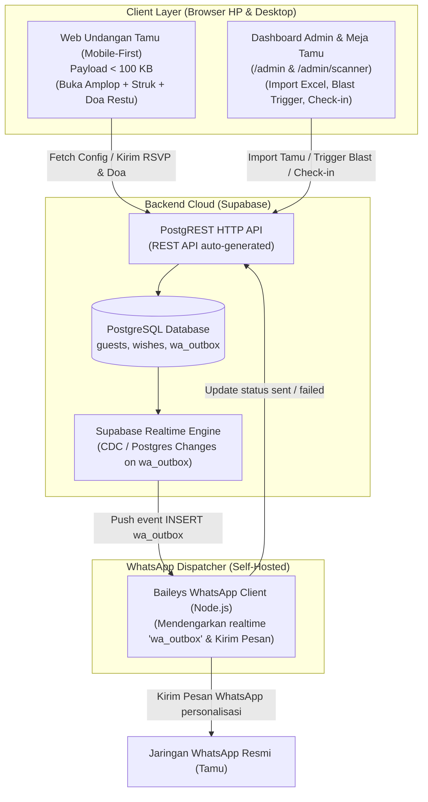
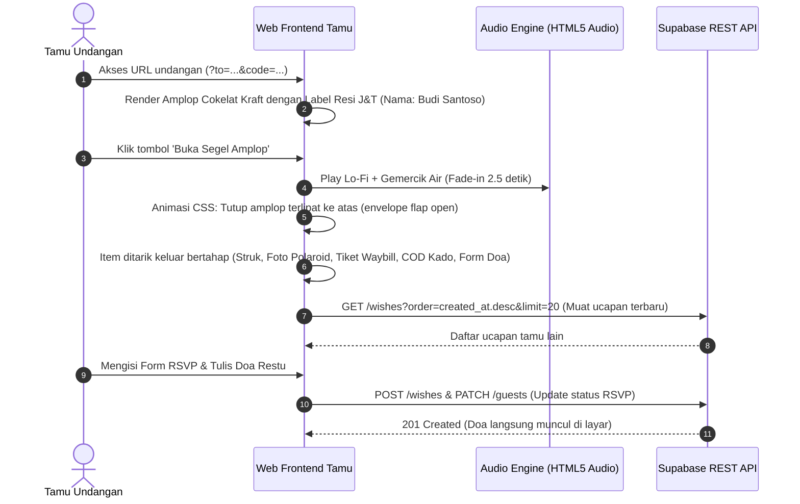
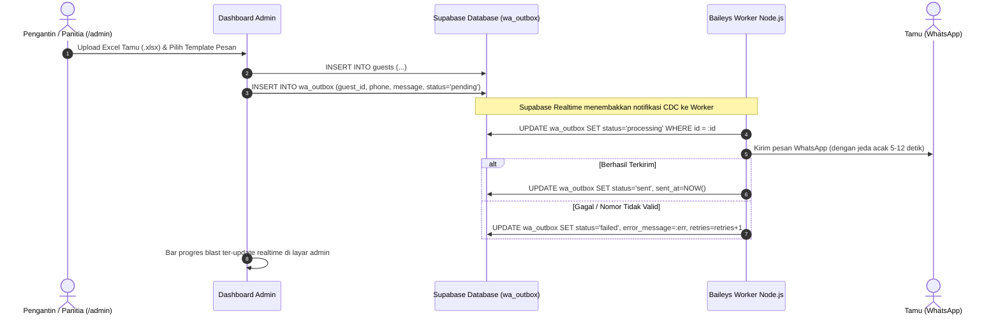
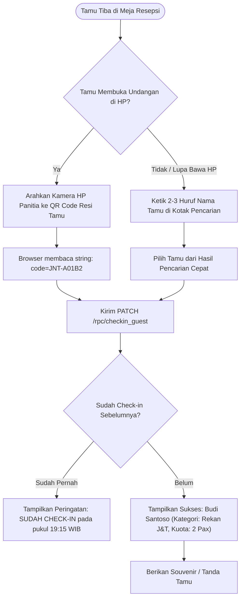

# ARCHITECTURE.md — Arsitektur Sistem & Performa

Dokumen ini mendefinisikan arsitektur sistem menyeluruh, pola interaksi antar komponen, dan strategi rekayasa performa untuk web undangan pernikahan dan sistem manajemen tamu.

---

## 1. Topologi Sistem & Diagram Komponen

Sistem terdiri dari 4 komponen utama yang terpisah secara modular:

---

## 2. Alur Pengalaman Tamu (Unboxing Amplop J&T)

Tamu menerima tautan personalisasi dengan parameter URL:  
`https://undangan.domain.id/?to=Budi+Santoso&code=JNT-A01B2`

---

## 3. Alur WhatsApp Blast & Antrean Pesan (Outbox Pattern)

Untuk menjaga keandalan dan mencegah nomor WhatsApp terblokir akibat *flooding*, digunakan pola **Transactional Outbox**:

---

## 4. Alur Check-in Meja Tamu di Hari H (Hybrid Protocol)

Petugas meja penerima tamu membuka halaman `/admin/scanner` menggunakan browser tablet atau HP:

---

## 5. Strategi Rekayasa Performa Ultra-Ringan (< 100 KB Target)

Untuk memenuhi syarat **"harus ringan"**, berikut batasan teknis wajib (*hard constraints*):

### A. Alokasi Bobot Halaman (Performance Budget)
| Kategori Aset | Batas Maksimal | Strategi Optimasi |
| :--- | :--- | :--- |
| **HTML Document** | $\le 15 \text{ KB}$ | Semantic HTML5, minified, critical CSS inlined. |
| **Styles (CSS)** | $\le 20 \text{ KB}$ | Tailwind CSS purged (hanya class yang dipakai) atau pure custom CSS tanpa framework berat. |
| **JavaScript** | $\le 25 \text{ KB}$ | Vanilla JavaScript murni, no React/Vue/Three.js di halaman tamu publik. |
| **Foto Polaroid (3-4 foto)** | $\le 80 \text{ KB}$ total | Format **WebP** kualitas 75, dimensi $600 \times 600 \text{ px}$, kompresi agresif. |
| **Audio File (Lo-Fi + Air)** | $\le 650 \text{ KB}$ | Audio mono **Opus / AAC 64 kbps**, durasi 1.5 menit looping, di-load secara asinkron (*lazy-fetch* saat user klik buka segel). |
| **Total Initial Load** | **$\le 100 \text{ KB}$** | Terbuka di bawah 0.4 detik pada jaringan 4G standar. |

### B. Anti-Patterns yang Diharamkan
1. **Dilarang memakai `<iframe>` Google Maps:** Satu embed iframe memuat 1.5 MB JS dan 30+ network requests. Sebagai gantinya, gunakan ilustrasi peta minimalis format SVG/WebP berukuran 8 KB dengan deep link langsung ke aplikasi Google Maps dan Waze (`geo:` / `https://maps.google.com/?q=...`).
2. **Dilarang auto-play audio sebelum user berinteraksi:** Browser mobile modern (Chrome, Safari iOS) memblokir autoplay audio tanpa gesture pengguna. Momen klik "Buka Segel Amplop" dimanfaatkan sebagai *user gesture* resmi untuk memulai Web Audio API.
3. **Dilarang mengimpor library icon font (seperti FontAwesome 500 KB):** Seluruh icon (centang, salin rekening, panah, sound on/off) wajib berupa inline SVG murni (< 1 KB per ikon).
