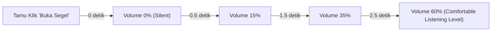

# DESIGN.md — Sistem Desain, Visual & Audio Ambience

Dokumen ini memuat spesifikasi desain antarmuka (UI/UX), token warna, tipografi, struktur metafora visual, animasi CSS murni, dan tata suara *ambience*.

---

## 1. Filosofi & Metafora Desain

Konsep visual mengusung tajuk:  
**"Toko Ritel $\times$ J&T Express: Transaksi Seumur Hidup"**

Desain ini menggabungkan dua dunia fungsional:
1. **Dunia Pengiriman J&T:** Amplop cokelat kraft pengiriman dokumen, label thermal resi bergaris merah khas J&T, stempel pengiriman, dan barcode paket.
2. **Dunia Kasir Toko Ritel:** Kertas struk kasir thermal panjang dengan tepi sobekan bergerigi, font monospace mekanis, dan rincian transaksi belanja yang penuh humor serta makna romantis.
3. **Sentuhan Kencan Santai (Personal):** Lembaran foto polaroid candid analog saat mencicipi kedai kopi baru, bermain stik di rental PS, dan menikmati ketenangan suara gemercik air di alam terbuka.

---

## 2. Palet Warna & Token Desain (Color Palette)

| Nama Token | Hex Code | Peran / Penggunaan |
| :--- | :--- | :--- |
| `--color-kraft-base` | `#E8D3B7` | Latar belakang badan amplop kraft airmail luar. |
| `--color-kraft-inner`| `#E2CDAD` | Latar belakang kertas manila di dalam border airmail. |
| `--color-kraft-dark` | `#BAA07D` | Bayangan lipatan flap amplop dan garis pembatas. |
| `--color-airmail-blue`| `#1E3A8A` | Warna biru navy pada garis belang-belang diagonal airmail klasik. |
| `--color-jnt-red` | `#E30613` | Warna aksen utama: logo J&T, tombol aksi, garis resi. |
| `--color-string-red` | `#991B1B` | Warna kancing bulat dan benang tali pengikat amplop. |
| `--color-thermal-paper` | `#FDFBF7` | Warna kertas struk kasir & lembar resi dalam (putih gading hangat). |
| `--color-thermal-border` | `#E7DFD5` | Garis putus-putus pembatas struk dan efek bayangan kertas. |
| `--color-coffee-dark` | `#2E1E12` | Warna teks utama struk dan judul (bukan hitam pekat #000, melainkan cokelat kopi pekat). |
| `--color-coffee-muted` | `#6E5D4F` | Teks pendukung, timestamp, dan catatan kaki. |
| `--color-polaroid-frame`| `#FFFFFF` | Bingkai putih foto polaroid vintage. |
| `--color-success` | `#16A34A` | Badge kehadiran "Pasti Hadir" dan indikator centang tersalin. |

---

## 3. Tipografi (Typography Hierarchy)

Untuk menjaga performa halaman tetap di bawah 100 KB, kami memanfaatkan **System Font Stacks** berkelas dengan cadangan font modern tanpa perlu men-download file font raksasa:

### A. Font Monospace (Kertas Struk Kasir & No. Resi)
Digunakan pada seluruh elemen struk kasir, rincian biaya transaksi, tabel akad, dan kode resi:
```css
font-family: 'Courier New', Courier, 'Cascadia Code', ui-monospace, monospace;
letter-spacing: -0.02em;
```

### B. Font Body & Interaksi (Formulir, Tombol, Label Amplop)
Digunakan pada navigasi, tombol, form input RSVP, dan modal pop-up:
```css
font-family: 'Plus Jakarta Sans', system-ui, -apple-system, BlinkMacSystemFont, 'Segoe UI', Roboto, sans-serif;
```

### C. Font Aksen Judul / Nama Mempelai
Digunakan pada nama kedua mempelai di header untuk memberikan sentuhan keanggunan pernikahan:
```css
font-family: 'Playfair Display', Georgia, serif;
font-style: italic;
font-weight: 700;
```

---

## 4. Anatomi Komponen Visual & Dokumen Kertas Mandiri

Setiap berkas di dalam amplop dirancang sebagai **lembaran dokumen fisik mandiri** dengan tekstur kertas yang berbeda, bayangan bertingkat (*layered 3D shadow*), kemiringan acak analog ($-1.5^\circ$ s/d $+2^\circ$), serta animasi peluncuran bertahap (*staggered slide-out animation*).

### 4.1 Amplop Tali Airmail Retro (String & Button Tie Envelope)
* **Border Airmail Klasik:** Tepian sekeliling amplop dihiasi garis diagonal belang-belang selang-seling merah (`#D32F2F`) dan biru navy (`#1E3A8A`) khas pengiriman pos udara (*Par Avion*).
* **Badan Kertas Kraft/Manila:** Latar belakang badan dalam amplop menggunakan tekstur kertas manila cokelat hangat (`#E2CDAD`) dengan bayangan realistis.
* **Tutup Amplop (Envelope Flap):** Berbentuk horizontal dengan sudut melengkung halus di bagian bawah (*rounded bottom corners*, `border-radius: 0 0 18px 18px`), melipat ke atas menggunakan CSS 3D `rotateX(180deg)` saat unboxing.
* **Mekanisme Kancing & Tali Merah (String & Button Closure):**
  * Dua kancing bulat merah tua (`#D32F2F`) dengan mata itik logam perak (*eyelet*) di bagian tengahnya: satu kancing berada di tutup atas dan satu lagi di badan amplop bawah.
  * Tali merah melilit vertikal menghubungkan kedua kancing dengan sisa ujung tali yang menjuntai realistis ke samping.
* **Badge Interaktif Buka Paket:**
  * Tombol interaktif berdenyut lembut (*pulse effect*) berlabel **"TARIK TALI PAKET"** menggantikan segel bulat konvensional, memberi panduan visual yang jelas bagi tamu di layar ponsel.

### 4.2 Label Resi Pengiriman J&T Ringkas (Clean Parcel Waybill)
* **Satu Lembar Bersih:** Hanya menampilkan lembar atas yang memang ditempelkan pada paket riil, tanpa bagian bawah atau garis potong `✂ xxxxx`.
* **Mobile-First Clarity:** Dioptimalkan secara khusus untuk lebar layar HP (360px – 430px) agar barcode, nomor resi, dan nama tamu penerima langsung terbaca jelas tanpa perlu diperbesar (*no zoom required*).
* **Grid Tabel Standar:**
  1. *Header:* Logo resmi **J&T CARGO**, barcode pengiriman tajam, nomor resi unik (`200417537039`), dan badge **FASTPAY**.
  2. *Pengirim & Penerima:* `Dari: Rian Pratama (Toko Ritel)` dan `Kepada: [Nama Tamu]` (dicetak tebal & menonjol) beserta label `FastTrack (FT)`.
  3. *Spesifikasi:* Berat `2 Jiwa`, tanggal transaksi, QR Code, dan badge `NON COD - CASHLESS (1/1)`.

### 4.3 Dokumen 1: Lembar Surat Cerita (Warm Story Letterhead)
* **Karakter Kertas:** Kertas surat berserat vintage (*cream stationery letter*, `#FAF6ED`) dengan bayangan tebal bertingkat dan kemiringan $-0.6^\circ$.
* **Elemen Visual:**
  * Stempel merah memorandum di pojok kanan atas: *"OFFICIAL MEMORANDUM"*.
  * Kop resmi: *"SURAT RESMI DARI MEJA KASIR & DROP POINT J&T"*.
  * Judul: *"Pertukaran Uang Pecahan Menuju Janji Seumur Hidup"*.
* **Narasi Runtut:** Menceritakan prolog pertemuan di meja kasir ritel yang membutuhkan uang kembalian pecahan Rp 2.000 & Rp 5.000 dengan kurir COD di seberang jalan, perjalanan kencan santai (kopi, rental PS, gemercik air alam), hingga permohonan doa restu.
* **Tanda Tangan:** Tanggal Jakarta, 28 November 2026 dan tanda tangan manis *Rian & Nisa*.

### 4.4 Dokumen 2: Struk Kasir Thermal ("Transaksi Seumur Hidup")
* **Karakter Kertas:** Kertas thermal printer POS putih gading tipis (`#FDFBF7`) dengan **tepian atas dan bawah bergerigi zigzag** (*sawtooth tear edges*) menggunakan `clip-path` murni.
* **Konten Transaksi & Jadwal:**
  * Rincian belanja cinta (1x Tukar Pecahan COD Rp 2.000 & Rp 5.000 = Rp 0,-, 100+ Cangkir Kopi = Tak Ternilai, 50+ Jam Sewa PS = Seru Banget, Gemercik Air = Adem di Jiwa).
  * Subtotal Sepakat Bersama, PPN 100% Sah, Total Janji Seumur Hidup.
  * Tabel resmi jadwal **Akad Nikah** (08:00 – 10:00 WIB, Masjid Baiturrahman) & **Resepsi** (11:00 – 14:00 WIB, Sasana Kriya Ballroom).
  * Barcode footer mesin kasir & catatan penutup romantis.

### 4.5 Dokumen 3: Tiga Keping Foto Polaroid Bercerita (Analog Prints)
* **Karakter Kertas:** Tiga lembar foto polaroid fisik lepas dengan bingkai putih tebal (`#FFFFFF`) dan bayangan realistis.
* **Aksen Masking Tape:** Setiap foto dilengkapi pita perekat kertas washi (*semi-transparent masking tape*) di bagian atas tengah yang merekatkannya ke latar belakang.
* **Sudut Kemiringan Analog:**
  * Foto 1 (Ngopi Santai): `transform: rotate(-1.5deg);`
  * Foto 2 (Gemercik Air Alam): `transform: rotate(2deg);`
  * Foto 3 (Rental PS Co-Op): `transform: rotate(-0.8deg);`
* **Narasi Cerita:** Masing-masing foto memiliki catatan tulisan narasi di bawahnya menceritakan makna di balik momen tersebut. Ketukan pada foto membuka modal tampilan penuh (*lightbox*).

### 4.6 Dokumen 4: Lembar Surat Jalan & Render Peta Simpel (Waybill Map Card)
* **Karakter Kertas:** Kertas manila berstempel pita merah *"SURAT JALAN / WAYBILL RUTE"* (`transform: rotate(-0.5deg)`).
* **Render Peta Simpel (Vector SVG):** Denah peta visual minimalis yang memuat:
  * Pin hijau lokasi Akad Nikah (Masjid Raya Baiturrahman).
  * Garis rute putus-putus merah sepanjang $\pm 1.8 \text{ km}$ (5 menit).
  * Pin merah lokasi Resepsi (Gedung Sasana Kriya Ballroom).
  * Ilustrasi Taman Budaya, aliran air sungai, dan kompas mata angin Utara.
* **Fitur Navigasi:** Live Countdown Timer (Hari, Jam, Menit, Detik), tombol ke **Google Maps**, **Waze**, dan **Simpan ke Google Calendar**.

### 4.7 Dokumen 5: Slip Paket COD Kado & Tanda Kasih Digital (Murni QRIS)
* **Karakter Kertas:** Slip tanda terima paket COD berstempel merah *"SLIP TITIPAN KADO & COD CINTA"*.
* **Bebas Nomor Rekening:** Tidak menampilkan nomor rekening bank manual (sesuai arahan pengguna).
* **Fitur Utama:**
  * Kartu **Kode QRIS Nasional** besar yang jelas di tengah untuk dipindai melalui mobile banking dan e-wallet (BCA Mobile, Livin', GoPay, OVO, ShopeePay, DANA), dengan fitur tap untuk memperbesar.
  * Rincian alamat **Drop Point J&T Express Palmerah** untuk kiriman paket kado fisik beserta tombol *"Salin Alamat Lengkap"*.

### 4.8 Dokumen 6: Kartu Konfirmasi Kehadiran (RSVP) & Dinding Doa
* **Karakter Kertas:** Kartu balasan resmi (*RSVP Return Card*) bertekstur karton halus.
* **Interaksi:** Input nama tamu otomatis dari URL, radio button kehadiran ("Pasti Hadir" / "Maaf, Berhalangan"), dropdown pax, form doa restu, tombol submit merah, dan Dinding Doa Realtime.

---

## 5. Tata Suara & Audio Ambience (Sound Design)

### 5.1 Karakter Musik
* **Bukan Lagu Mengagetkan:** Tidak menggunakan musik pop/orkestra bervolume keras yang langsung meledak saat web dibuka.
* **Karakter:** Perpaduan instrumen petikan gitar akustik Lo-Fi yang hangat dan santai, dipadu dengan rekaman alami suara gemercik air sungai yang mengalir tenang.
* **Volume Mastering:** Dinormalisasi pada kisaran **-16 LUFS** (lembut dan tidak mengganggu percakapan atau aktivitas tamu yang sedang memegang HP).

### 5.2 Alur Transisi Audio (Fade-In Curve)


### 5.3 Komponen Floating Audio Player
* Berada di pojok kanan atas layar (`position: fixed; top: 16px; right: 16px; z-index: 50;`).
* Desain berupa *capsule pill* transparan dengan efek kaca (*glassmorphism*):  
  `background: rgba(253, 251, 247, 0.85); backdrop-filter: blur(8px);`.
* Dilengkapi visualisasi sederhana 3 garis equalizer kecil yang bergerak naik-turun saat audio berputar, dan diam saat di-mute.
