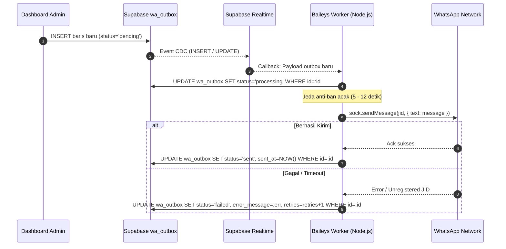

# INTEGRATION_BAILEYS.md — Spesifikasi Integrasi Worker Baileys & WA Outbox

Dokumen ini merupakan panduan teknis bagi pengembang yang mengelola **Worker Baileys WhatsApp**. Sistem ini mendengarkan baris baru pada tabel `wa_outbox` di Supabase secara **Realtime** dan mengirimkan pesan undangan terpersonalisasi ke tamu.

---

## 1. Topologi Antrean Pesan (Outbox Pattern)



---

## 2. Format Pesan Undangan & Placeholder

Pesan dikirimkan berupa **Teks Terpersonalisasi + Link Langsung**. 

### Variabel yang Didukung:
* `{{nama}}` $\rightarrow$ Nama lengkap tamu undangan (contoh: *Budi Santoso & Partner*).
* `{{link}}` $\rightarrow$ URL undangan lengkap dengan parameter (contoh: `https://undangan.domain.id/?to=Budi+Santoso&code=JNT-K9F2`).
* `{{kode}}` $\rightarrow$ Kode resi unik tamu (contoh: *JNT-K9F2*).
* `{{kategori}}` $\rightarrow$ Kategori tamu (contoh: *Rekan J&T*).
* `{{pax}}` $\rightarrow$ Kuota jumlah tamu yang diundang (contoh: *2*).

### Contoh Teks Pesan Template:
```text
Halo {{nama}},

Ada paket spesial yang siap kamu unboxing! 📦
Bukan paket barang kiriman biasa, melainkan kabar bahagia dan undangan pernikahan kami berdua:

Buka paket undanganmu di sini:
👉 {{link}}

No. Resi Pengiriman: {{kode}}
Kuota Tamu: {{pax}} Orang

Merupakan suatu kehormatan dan kebahagiaan bagi kami apabila kamu berkenan hadir dan memberikan doa restu.

Salam hangat,
[Nama Mempelai Pria] & [Nama Mempelai Wanita]
```

---

## 3. Aturan Normalisasi Nomor Telepon (JID WhatsApp)

Nomor yang diinput admin melalui Excel atau form bisa beragam formatnya (`0812...`, `+62812...`, `62812...`, atau menggunakan spasi/strip). 

Worker wajib menerapkan fungsi normalisasi berikut sebelum memanggil `sock.sendMessage`:

```typescript
function formatToWhatsAppJid(phone: string): string {
    // 1. Hapus semua karakter non-digit
    let clean = phone.replace(/\D/g, '');

    // 2. Ubah format awalan lokal '08' menjadi '628'
    if (clean.startsWith('0')) {
        clean = '62' + clean.slice(1);
    }

    // 3. Pastikan berakhiran @s.whatsapp.net
    return `${clean}@s.whatsapp.net`;
}
```

---

## 4. Strategi Anti-Blokir (Anti-Ban & Rate Limiting)

Untuk menjaga nomor WhatsApp pengirim tetap aman dan tidak terdeteksi sebagai spammer oleh algoritma WhatsApp:
1. **Jeda Waktu Acak (Random Jitter Delay):**  
   Wajib memberi jeda tidur acak antara **5.000 ms hingga 12.000 ms** sebelum mengirim pesan berikutnya.
2. **Status "Sedang Mengetik" (Composing Presence):**  
   Kirimkan event `sock.sendPresenceUpdate('composing', jid)` selama 2–3 detik sebelum pesan di-submit agar terlihat alami seperti manusia.
3. **Maksimal Batch Pengiriman:**  
   Batas pengiriman disarankan maksimal **50–80 pesan per jam** untuk nomor WhatsApp yang sudah memiliki reputasi baik.

---

## 5. Skrip Referensi Worker Node.js (TypeScript)

Berikut adalah contoh skrip listener mandiri yang siap Anda sesuaikan dengan project Baileys yang sudah berjalan:

```typescript
import { createClient } from '@supabase/supabase-js';
import makeWASocket, { 
    useMultiFileAuthState, 
    DisconnectReason 
} from '@whiskeysockets/baileys';
import pino from 'pino';

// Inisialisasi Supabase Client (Gunakan SERVICE_ROLE_KEY untuk bypass RLS)
const SUPABASE_URL = process.env.SUPABASE_URL || 'https://xyz.supabase.co';
const SUPABASE_SERVICE_ROLE_KEY = process.env.SUPABASE_SERVICE_ROLE_KEY || 'your-service-role-key';

const supabase = createClient(SUPABASE_URL, SUPABASE_SERVICE_ROLE_KEY);

// Fungsi jeda acak
const sleep = (ms: number) => new Promise(resolve => setTimeout(resolve, ms));
const randomDelay = (min: number, max: number) => 
    Math.floor(Math.random() * (max - min + 1)) + min;

async function startBaileysWorker() {
    const { state, saveCreds } = await useMultiFileAuthState('./baileys_auth');
    
    const sock = makeWASocket({
        auth: state,
        logger: pino({ level: 'silent' }),
        printQRInTerminal: true
    });

    sock.ev.on('creds.update', saveCreds);

    sock.ev.on('connection.update', (update) => {
        const { connection, lastDisconnect } = update;
        if (connection === 'close') {
            const shouldReconnect = 
                (lastDisconnect?.error as any)?.output?.statusCode !== DisconnectReason.loggedOut;
            console.log('Koneksi terputus. Mencoba reconnect:', shouldReconnect);
            if (shouldReconnect) startBaileysWorker();
        } else if (connection === 'open') {
            console.log('✅ Client Baileys Berhasil Terhubung ke WhatsApp!');
            initOutboxListener(sock);
        }
    });
}

async function initOutboxListener(sock: any) {
    console.log('📡 Memulai listener Supabase Realtime untuk tabel wa_outbox...');

    // 1. Tangani pesan pending yang tertinggal saat worker offline
    await processPendingQueue(sock);

    // 2. Dengarkan event INSERT baru secara realtime
    supabase
        .channel('wa_outbox_channel')
        .on(
            'postgres_changes',
            { event: 'INSERT', schema: 'public', table: 'wa_outbox', filter: 'status=eq.pending' },
            async (payload) => {
                console.log('📩 Pesan baru masuk antrean outbox:', payload.new.id);
                await dispatchMessage(sock, payload.new);
            }
        )
        .subscribe();
}

async function processPendingQueue(sock: any) {
    const { data: pendingRows, error } = await supabase
        .from('wa_outbox')
        .select('*')
        .eq('status', 'pending')
        .order('created_at', { ascending: true })
        .limit(20);

    if (error) {
        console.error('Error mengambil pending outbox:', error);
        return;
    }

    for (const row of pendingRows || []) {
        await dispatchMessage(sock, row);
    }
}

async function dispatchMessage(sock: any, outboxItem: any) {
    const { id, phone, message } = outboxItem;

    // Tandai status sedang diproses
    await supabase
        .from('wa_outbox')
        .update({ status: 'processing' })
        .eq('id', id);

    try {
        const jid = formatToWhatsAppJid(phone);

        // Simulasi presence 'composing'
        await sock.sendPresenceUpdate('composing', jid);
        const delay = randomDelay(5000, 10000);
        console.log(`⏳ Menunggu jeda anti-ban ${delay}ms untuk ${phone}...`);
        await sleep(delay);

        // Kirim pesan teks
        await sock.sendMessage(jid, { text: message });
        await sock.sendPresenceUpdate('paused', jid);

        // Update status sukses
        await supabase
            .from('wa_outbox')
            .update({ 
                status: 'sent', 
                sent_at: new Date().toISOString() 
            })
            .eq('id', id);

        console.log(`✅ Sukses kirim pesan ke: ${phone}`);
    } catch (err: any) {
        console.error(`❌ Gagal kirim ke ${phone}:`, err.message);

        await supabase
            .from('wa_outbox')
            .update({ 
                status: 'failed', 
                error_message: err.message,
                retries: (outboxItem.retries || 0) + 1 
            })
            .eq('id', id);
    }
}

function formatToWhatsAppJid(phone: string): string {
    let clean = phone.replace(/\D/g, '');
    if (clean.startsWith('0')) clean = '62' + clean.slice(1);
    return `${clean}@s.whatsapp.net`;
}

// Jalankan worker
startBaileysWorker();
```
